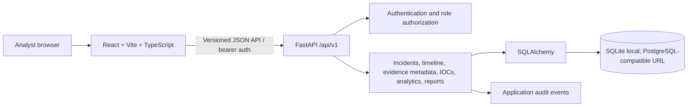

# CyberShield — Incident Response & Investigation Dashboard

CyberShield is an educational incident-response workspace for recording and investigating synthetic or explicitly imported security alerts. It demonstrates incident case management, timeline documentation, evidence metadata, IOC tracking, database-derived analytics, reports, and application audit history. It does not assert that a real attack is underway and does not automate offensive actions.

## Architecture



### Repository layout

```text
backend/
  app/                 FastAPI API, ORM models, validation, services
  tests/               Pytest API and service tests
  requirements.txt     Pinned Python dependencies
frontend/
  src/                 React pages, shared components, and API client
  package.json         Frontend dependencies and scripts
docs/
  architecture.md
  api-guide.md
  incident-response-workflow.md
  security-model.md
.env.example
```

The backend is authoritative for validation and permissions. The browser must not be trusted with authorization decisions. Evidence is metadata-only in this version; there is no public file storage or upload path.

## Features

- Authenticated, role-aware access for administrators, analysts, and viewers.
- Searchable, filterable, server-paginated incident records and investigation timelines.
- Dashboard and analytics values calculated from persisted records.
- Evidence metadata and SHA-256 fields; a hash alone does not prove evidence authenticity.
- Validated IOC records, including IPs, domains, URLs, email addresses, and file hashes.
- Printable incident reports and structured export/import paths where implemented.
- Append-only through normal application operations audit history. SQLite is not tamper-proof against a host administrator.
- Synthetic sample cases are marked as simulated; imported alerts remain distinguishable from confirmed incidents.

See [security-model.md](./docs/security-model.md) for boundaries and limitations.

## Technology

- Frontend: React, Vite, TypeScript, Tailwind CSS, React Router, Lucide React, Recharts, React Hook Form, Zod, Vitest, React Testing Library.
- Backend: Python 3, FastAPI, Pydantic, SQLAlchemy, Alembic, pytest.
- Database: SQLite for local use. A PostgreSQL-compatible SQLAlchemy connection URL can be used where supported.

## Local setup

Prerequisites: Python 3.10+ and Node.js 20+ (or versions required by the manifests).

1. Create local config and a virtual environment:

   ```bash
   cd backend
   cp ../.env.example .env
   python3 -m venv .venv
   . .venv/bin/activate
   ```

2. Install backend dependencies and configure a strong local secret:

   ```bash
   pip install -r requirements.txt
   export JWT_SECRET="$(python -c 'import secrets; print(secrets.token_urlsafe(48))')"
   ```

   The backend reads `.env` from its current working directory. Copy the root example to `frontend/.env.local` if Vite should load its API URL from a file. Do not commit `.env`, real credentials, local databases, or evidence. Use a managed secret store and TLS for deployed instances.

3. Initialize the database and create a user with a password you choose:

   ```bash
   alembic upgrade head
   python -m app.cli create-user --username admin --email admin@example.test --role admin
   python -m app.cli create-user --username analyst --email analyst@example.test --role analyst
   python -m app.cli create-user --username viewer --email viewer@example.test --role viewer
   python -m app.cli seed-demo
   ```

   Passwords are entered interactively and are never supplied as command-line arguments. Seed data is synthetic and idempotent; it does not create demo users or credentials. Run `python -m app.cli --help` for available administrative commands.

4. Start API and frontend in separate terminals:

   ```bash
   cd backend
   .venv/bin/uvicorn app.main:app --reload
   ```

   ```bash
   cd frontend
   cp ../.env.example .env.local
   npm install
   npm run dev
   ```

   Set the frontend API base URL to `http://localhost:8000/api/v1` using `VITE_API_BASE_URL` (or the frontend's documented configuration). The backend OpenAPI UI is at `http://localhost:8000/docs`.

> Check each package README and manifest for the exact setup command and environment variable names; configuration is validated at startup.

## Database, seed data, migration

The database schema is managed by Alembic (`cd backend && alembic upgrade head`). Seed examples use documentation-only addresses and are labeled simulated. Do not seed production data.

For a local backup, stop writes and copy the SQLite database file and any associated application configuration that is needed for restoration. Restore into a protected location, verify database integrity, and restrict permissions. SQLite application audit records are not equivalent to remote immutable logging.

## Development and tests

```bash
# Backend
cd backend
../backend/.venv/bin/pytest -q

# Frontend
cd frontend
npm test
npm run build
```

Only report test results that were actually run; check the latest implementation notes below as development proceeds.

## API documentation

Start FastAPI, then visit `http://localhost:8000/docs` or `/openapi.json`. See [api-guide.md](./docs/api-guide.md) for endpoint areas and usage boundaries. All operational routes should require authentication and enforce authorization on the server.

## Screenshots

No screenshots are included yet. Capture the running application at mobile, tablet, and desktop widths after local setup. Do not use screenshots containing real personal or sensitive incident data.

## Security and ethical use

Use only synthetic data or alerts you are authorized to process. Never include secrets in notes or reports. IOC URLs and files are untrusted and must not be automatically visited or executed. This project does not block external IP addresses or deliver payloads. For deployment, use TLS, a strong secret manager-backed key, restricted CORS, patched dependencies, protected backups, and external append-only audit retention.

The application is an educational portfolio project, not a certified or independently audited incident-response platform. Metadata-only evidence records do not provide full chain-of-custody guarantees.

## Known limitations and future improvements

- A live Wazuh integration is not configured. Future ingestion requires credentials, a documented mapping, safe validation, and integration testing.
- Production use would require external immutable audit retention, operational monitoring, stronger deployment controls, backup/restore drills, and a formal security review.
- Mean time to triage/resolution is shown as insufficient when explicit timestamps are not available; no PDF generator or live Wazuh connector is configured.
- Evidence storage is metadata-only. Full file custody requires a separately designed and reviewed protected storage service.

## Portfolio notes

Resume-ready descriptions should reflect only the verified implementation:

- Built a full-stack incident-management application with a typed React client and versioned FastAPI service.
- Implemented database-backed case tracking, investigation notes, metadata-only evidence handling, IOC records, and audit events.
- Added automated API/UI tests and documented the security limitations of local SQLite-backed audit history.

Do not claim security certification, deployment metrics, real incident-response experience, or an operational Wazuh integration unless independently established.

## License

Choose and add a license before publishing publicly. MIT is a common option for an educational portfolio project, but confirm that it suits the project’s intended use and any included dependencies.
# CYBERSHIELD-INCIDENTRESPONSE-INVESTIGATIONDASHBOARD
# CYBERSHIELD-INCIDENTRESPONSE-INVESTIGATIONDASHBOARD
