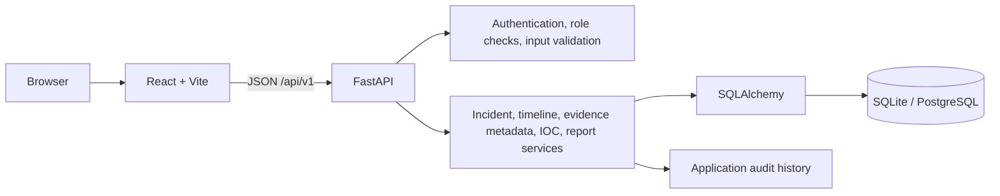

# Architecture

The client is a React single-page application. It makes authenticated requests to versioned FastAPI routes. API request schemas validate user-controlled input, and SQLAlchemy persists normalized application records. SQLite is the default for local development; database configuration should permit a PostgreSQL-compatible URL.

Browser inputs and imported alert values are untrusted. Evidence is metadata-only unless a later secure file-storage implementation is completed. SQLite audit entries can be altered by someone with direct database access; production systems need external append-only retention.
